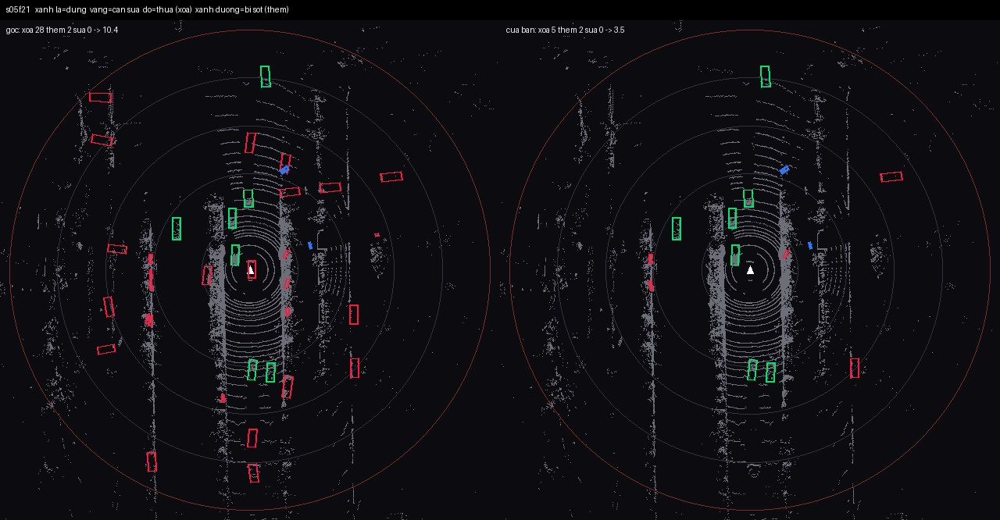

# Báo cáo Day 14 — Mai Quang Khải — 2A202603204

- Mã học viên dùng với `--student`: `204`
- `seed_tag` trong `frames_A.txt`: `393590736f`

## 1. Dự đoán trước sweep (bước 5b)

Ghi **trước** khi chạy `scripts/pp_sweep.py`, rồi commit và push ngay (lịch sử commit là bằng chứng thời điểm viết). Không sửa phần này sau khi có kết quả.

- Tham số tôi nghĩ giảm công sửa nhiều nhất: score\_thr
- Vì sao (nhìn ảnh BEV tập A: box thừa nhiều hay box sót nhiều?): Box thừa nhiều
    - Nhiều box đè lên cây ven đường, hầu hết có score thấp (lá cây, background,...)

## 2. Tập A: sửa tay và tune

| Cấu hình | Xóa | Thêm | Sửa | Chi phí |
| --- | ---: | ---: | ---: | ---: |
| Gốc | 58 | 5 | 6 | 25.4 |
| `best_config.json` | 14 | 12 | 3 | 17.7 |

- Tham số đã đổi trong `best_config.json`: `score_thr: 0.1 -> 0.5`, `min_points: 0 -> 5`
- Kết quả leave-one-out (dán các dòng `scripts/pp_sweep.py` in ra):\
  s01f10: cấu hình chọn {'score\_thr': '0.5', 'min\_points': '5'} → 6.4 (tốt nhất có thể 6.4)\
  s03f08: cấu hình chọn {'score\_thr': '0.5', 'min\_points': '5'} → 7.8 (tốt nhất có thể 5.9)\
  s05f21: cấu hình chọn {'score\_thr': '0.5', 'min\_points': '5'} → 3.5 (tốt nhất có thể 3.5)
- Cấu hình có ổn định trên từng frame không? Vì sao tôi vẫn chọn (hoặc không chọn) nó: Cấu hình không ổn định trên từng frame, có sự tăng cost ở s03f08 (6.2 → 7.8, oracle 5.9). Tuy nhiên, total cost vẫn giảm tới 30% (25.4 → 17.7).

## 3. Trước/sau (bước 8)

- `scripts/pp_compare.py` báo giảm 30% công sửa trên tập A (25.4 → 17.7).
- Dự đoán ở mục 1 đúng hay sai? Giải thích bằng số box xóa/thêm/sửa:
    - Dự đoán ở mục 1 là **đúng** (`score_thr` giảm công sửa nhiều nhất, đưa chi phí tập A giảm 30% từ 25.4 xuống 17.7).
    - Trade-off: xóa giảm mạnh 58 → 14 (-13.2 chi phí), sửa giảm 6 → 3 (-1.5), trong khi thêm tăng 5 → 12 (+7.0 chi phí) → tổng giảm ròng 7.7 (-30%).

## 4. Tập B

Số đo từ `scripts/pp_prelabel.py --frames d14_204/frames_B.txt --config d14_204/best_config.json --gt d14_204/ref_B.json`:

| Xóa | Thêm | Sửa | Chi phí |
| ---: | ---: | ---: | ---: |
| 37 | 26 | 7 | 40.6 |

- Loại box tốn công sửa nhất ở tập B: missing\_boxes (26 × 1.0 = 26.0, 64% của tổng 40.6 total cost), out\_of\_bound (cuboid đánh nhầm ở các vị trí bụi cây, hàng rào có hình dạng LiDar )

## 5. Giới hạn

- Frame tune quá ít: chỉ có 3 frame tune cho Set A
- KITTI 3-class model không có Bus/Truck và miss các người ở xa pedestrian/cyclist
